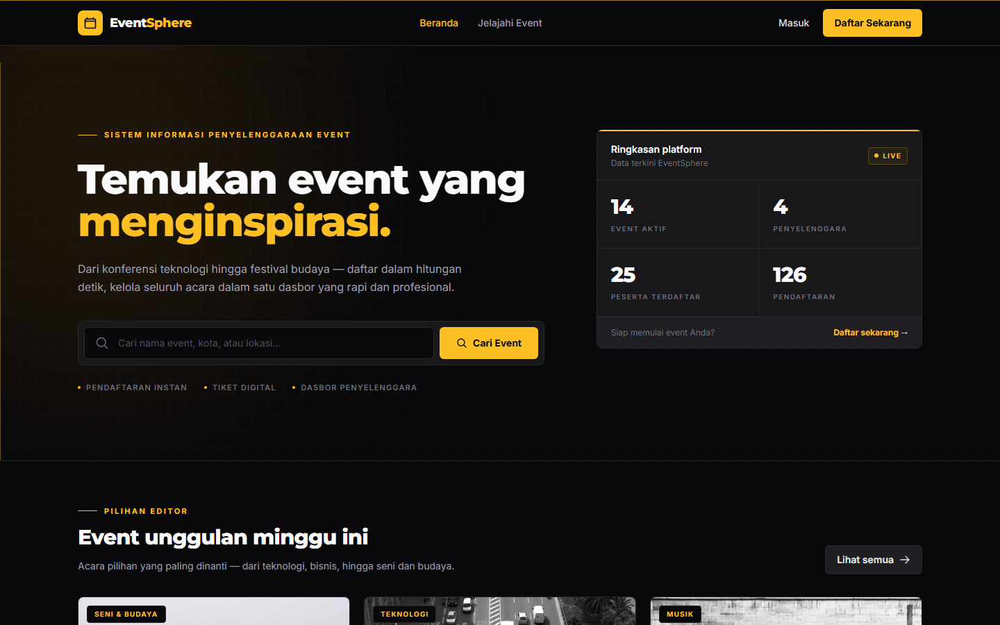
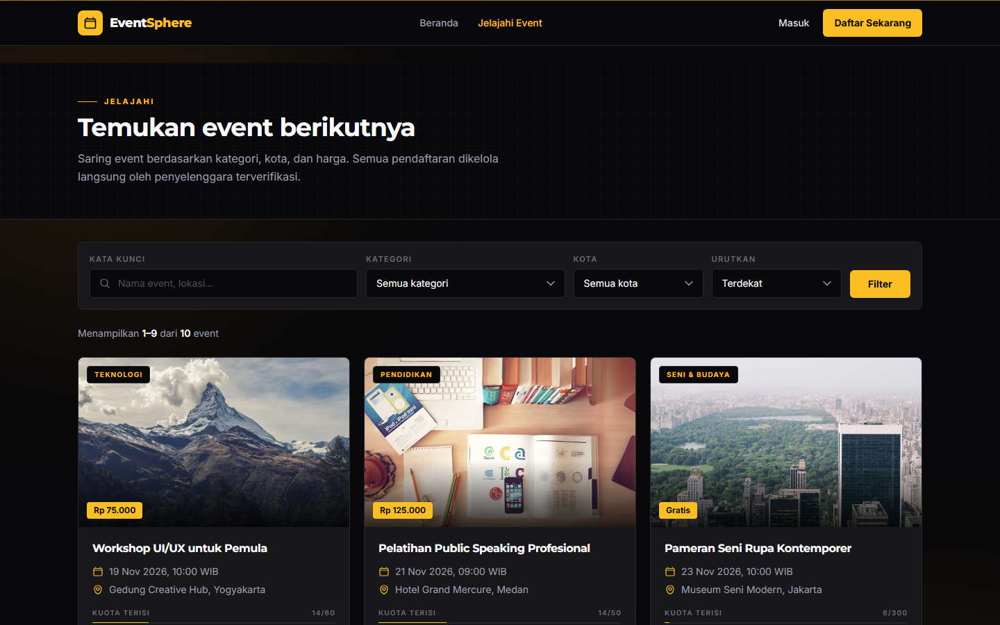
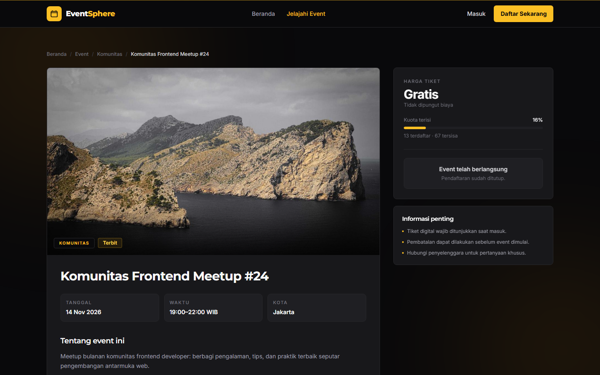

<div align="center">

# EventSphere

**Sistem Informasi Penyelenggaraan Event Berbasis Web**

Katalog event, pendaftaran online, tiket digital, dan dasbor pengelolaan event dalam satu platform.

[Dokumentasi](#dokumentasi) · [Instalasi](#instalasi) · [Akun Demo](#akun-demo) · [Pengujian](#pengujian)

</div>



## Tentang Proyek

EventSphere menghubungkan peserta dengan penyelenggara event. Pengunjung dapat menelusuri
katalog event, peserta mendaftar dan memperoleh tiket digital, penyelenggara mengelola event
dan memverifikasi kehadiran, sedangkan administrator memoderasi event, kategori, pengguna,
dan melihat laporan global.

Aplikasi dibangun dengan Laravel 13 dan Tailwind CSS 4, menggunakan tema gelap
**Midnight Gold**, serta seluruh antarmuka berbahasa Indonesia.

| Katalog Event | Detail Event |
| --- | --- |
|  |  |

## Peran Pengguna

| Peran | Hak Akses |
| --- | --- |
| Pengunjung | Melihat beranda, mencari dan memfilter event, melihat detail event, registrasi dan login |
| Peserta | Mendaftar event, melihat tiket digital, membatalkan atau mengaktifkan pendaftaran, mengelola profil |
| Penyelenggara | Membuat, mengubah, dan menghapus event sendiri, melihat pendaftar, mencatat kehadiran, melihat pendapatan |
| Administrator | Mengelola kategori, memoderasi seluruh event, mengelola pengguna dan peran, melihat seluruh pendaftaran dan statistik |

## Fitur Utama

- **Katalog publik** dengan pencarian, filter kategori/kota, dan pengurutan (terdekat, terbaru, termurah, terpopuler).
- **Pendaftaran event** dengan pencegahan pendaftaran ganda, pengecekan kuota, dan pembatalan sebelum event dimulai.
- **Tiket digital** dengan kode unik `EVS-XXXXXXXX` dan visual QR.
- **Dasbor peserta** berisi statistik, event mendatang, riwayat, dan rekomendasi event.
- **Dasbor penyelenggara** berisi jumlah event, pendaftaran, pendapatan terkonfirmasi, dan aktivitas terbaru.
- **Manajemen pendaftar** dengan pencarian kode tiket/nama/email, filter status, dan verifikasi kehadiran.
- **Moderasi administrator** untuk event, kategori, pengguna, dan seluruh pendaftaran.
- **Keamanan berlapis** melalui middleware peran, `EventPolicy`, Form Request, CSRF, dan hashing kata sandi.

## Teknologi

| Kategori | Teknologi |
| --- | --- |
| Bahasa | PHP 8.3+ (diuji pada PHP 8.4) |
| Framework | Laravel 13 |
| Tampilan | Blade, Tailwind CSS 4, Montserrat & Inter |
| Basis data | SQLite (default) atau MySQL |
| Build aset | Vite 8 + script `scripts/build-assets.mjs` |
| Pengujian | PHPUnit 12 |
| Formatter | Laravel Pint |

## Instalasi

### Prasyarat

- PHP 8.3 atau lebih baru beserta ekstensi `pdo_sqlite` (atau `pdo_mysql`)
- Composer 2
- Node.js 20+ dan npm

### Langkah

```bash
git clone https://github.com/si-oss08/event-sphere.git
cd event-sphere

composer install
cp .env.example .env        # Windows: copy .env.example .env
php artisan key:generate

# SQLite (default)
touch database/database.sqlite   # Windows: New-Item database/database.sqlite

php artisan migrate --seed
php artisan storage:link

npm install
npm run build
```

### Menjalankan Aplikasi

Cara termudah, menjalankan server, queue, dan pemantau aset sekaligus:

```bash
composer run dev
```

Atau secara terpisah:

```bash
php artisan serve
npm run dev
```

Pengguna **Laravel Herd** cukup meletakkan folder proyek di direktori Herd, lalu membuka
`http://eventsphere.test` tanpa menjalankan `php artisan serve`.

> Aset frontend dibangun ke `public/build`. Jika tampilan tidak berubah atau muncul
> *"Unable to locate file in Vite manifest"*, jalankan `npm run build`.

## Akun Demo

Data contoh dibuat oleh `php artisan migrate --seed`:

| Peran | Email | Kata sandi |
| --- | --- | --- |
| Administrator | `admin@eventsphere.test` | `password` |
| Penyelenggara | `organizer@eventsphere.test` | `password` |
| Peserta | `participant@eventsphere.test` | `password` |

## Pengujian

```bash
php artisan test --compact
```

Saat ini terdapat **58 test** dengan **180 assertion** yang mencakup autentikasi,
pembatasan akses peran, katalog publik, pendaftaran event, pembatalan pendaftaran,
kepemilikan tiket, serta pengelolaan event oleh penyelenggara.

## Struktur Proyek

```text
app/
├── Http/
│   ├── Controllers/          # Publik, Auth, Admin, Organizer, Participant
│   ├── Middleware/           # EnsureUserHasRole
│   └── Requests/             # Validasi form event
├── Models/                   # User, Category, Event, Registration
├── Policies/                 # EventPolicy
├── EventStatus.php
├── RegistrationStatus.php
└── UserRole.php
database/
├── factories/
├── migrations/
└── seeders/                  # Data demo siap pakai
docs/
├── analisis-kebutuhan.md
├── rancangan-sistem.md       # Arsitektur, basis data, proses, keamanan
├── pengembangan-aplikasi.md  # Implementasi, tantangan, deployment
├── pengujian.md              # Skenario dan hasil pengujian
├── diagram-mermaid.md
├── drawio/                   # Sumber diagram yang dapat diedit
├── images/                   # Wireframe 24 halaman
└── screenshots/              # Tangkapan layar aplikasi
resources/
├── css/app.css               # Design system Midnight Gold
└── views/                    # Blade per peran
routes/web.php
tests/Feature/
```

## Dokumentasi

| Tahapan | Dokumen |
| --- | --- |
| Analisis kebutuhan | [docs/analisis-kebutuhan.md](docs/analisis-kebutuhan.md) |
| Rancangan sistem | [docs/rancangan-sistem.md](docs/rancangan-sistem.md) · [PDF](docs/rancangan-sistem.pdf) |
| Pengembangan aplikasi | [docs/pengembangan-aplikasi.md](docs/pengembangan-aplikasi.md) · [PDF](docs/pengembangan-aplikasi.pdf) |
| Diagram sistem | [docs/diagram-mermaid.md](docs/diagram-mermaid.md), [docs/drawio](docs/drawio) |
| Desain UI/UX | [DESIGN.md](DESIGN.md), [docs/images/sketsa-ui.svg](docs/images/sketsa-ui.svg), [docs/images](docs/images) |
| Pengujian sistem | [docs/pengujian.md](docs/pengujian.md) · [PDF](docs/pengujian.pdf) |
| Tangkapan layar | [docs/screenshots](docs/screenshots) |

## Tim

**Kelompok ErrorWeb — Kelas 5.2**

| Nama | NIM |
| --- | --- |
| Ozra Ferdian | 20105111054 |
| Muhammed Ferdy | 20105111058 |

Dosen Pengampu: **Zikrul Khalid**

## Rencana Pengembangan

- Integrasi payment gateway dan status pembayaran tiket.
- QR tiket yang dapat dipindai dan halaman pemindaian tiket untuk panitia.
- Notifikasi email transaksional, verifikasi email, dan reset kata sandi.
- Ekspor laporan pendaftaran dan pendapatan (CSV/PDF).
