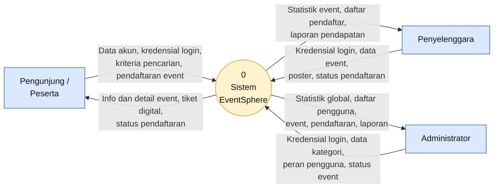
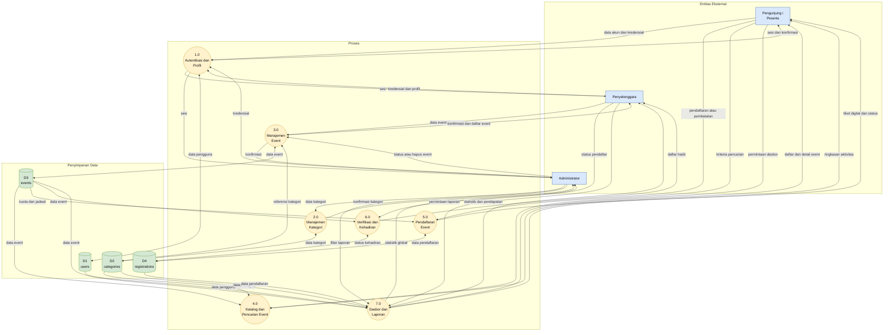
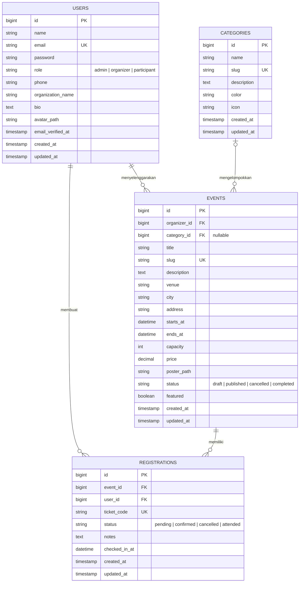
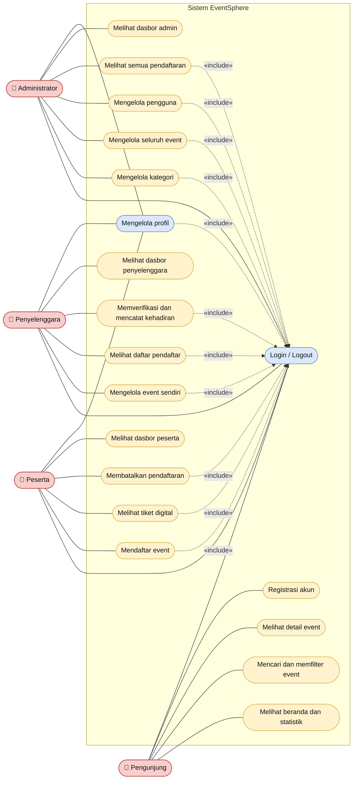
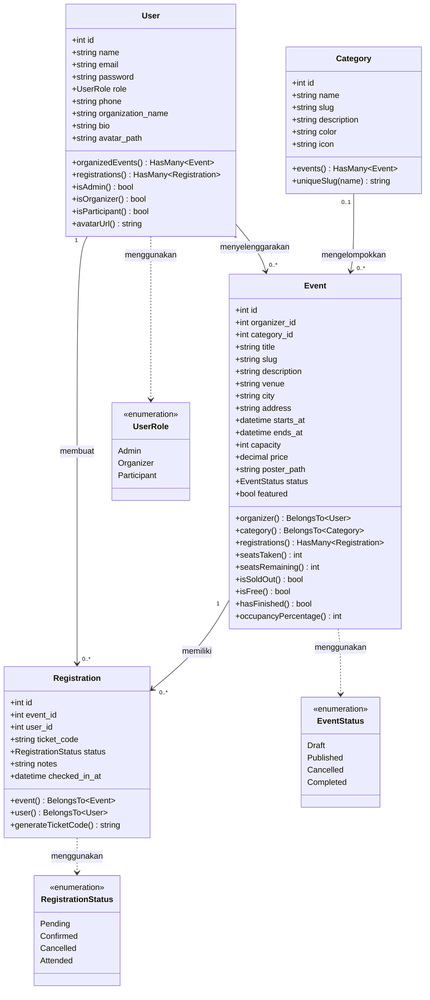
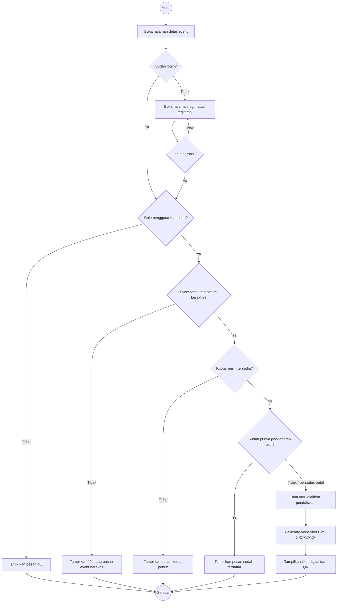
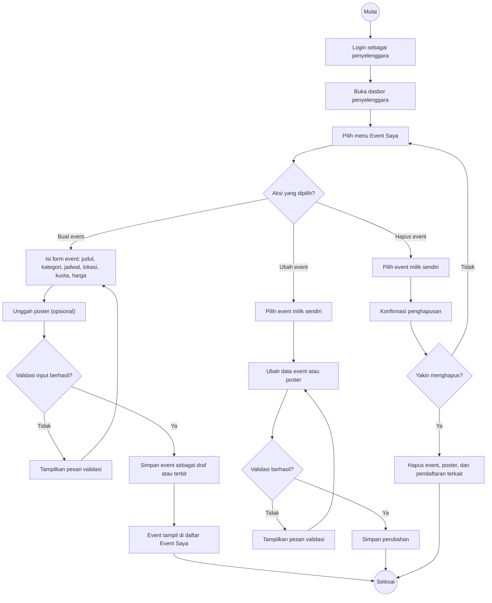
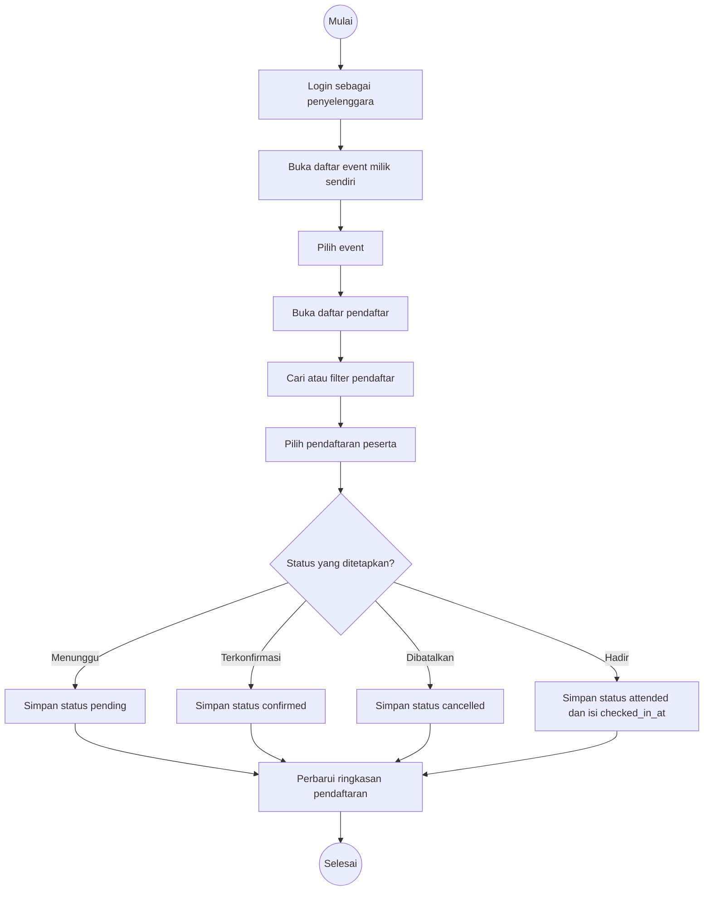

# Diagram Sistem EventSphere (Mermaid)

Semua diagram di bawah dapat dirender langsung di GitHub, VS Code, Obsidian, atau
[Mermaid Live Editor](https://mermaid.live). Sumber draw.io tersedia di folder
`docs/drawio/` untuk versi yang dapat diedit secara visual.

---

## 1. DFD Diagram Konteks

Menunjukkan sistem sebagai satu proses tunggal (`0`) beserta entitas eksternal dan
arus data utama yang melewati batas sistem.

---

## 2. DFD Level 0

Dekomposisi proses `0` menjadi tujuh proses utama dan empat penyimpanan data:
`D1 users`, `D2 categories`, `D3 events`, dan `D4 registrations`.

> Mermaid menata posisi simpul secara otomatis, sehingga urutan angka proses tidak
> selalu kiri ke kanan. Untuk tata letak yang terkontrol dan siap cetak, gunakan
> `docs/drawio/02-dfd-level-0.drawio` atau halaman **DFD Level 0** pada file
> `EventSphere-semua-diagram.drawio`.

### Keterangan proses

| Proses | Nama | Deskripsi singkat |
| --- | --- | --- |
| 1.0 | Autentikasi dan Profil | Registrasi, login/logout, pengelolaan profil dan avatar |
| 2.0 | Manajemen Kategori | CRUD kategori oleh administrator |
| 3.0 | Manajemen Event | CRUD event, poster, dan perubahan status oleh penyelenggara/admin |
| 4.0 | Katalog dan Pencarian Event | Beranda, daftar event, filter, pencarian, dan detail event |
| 5.0 | Pendaftaran Event | Pendaftaran, pembatalan, aktivasi ulang, dan pembuatan tiket |
| 6.0 | Verifikasi dan Kehadiran | Perubahan status pendaftaran dan pencatatan kehadiran |
| 7.0 | Dasbor dan Laporan | Statistik, ringkasan aktivitas, dan laporan pendapatan |

---

## 3. ERD (Entity Relationship Diagram)

Relasi utama: satu penyelenggara memiliki banyak event, satu kategori memiliki banyak
event, satu peserta memiliki banyak pendaftaran, dan satu event memiliki banyak
pendaftaran. Kombinasi `event_id + user_id` pada `registrations` bersifat unik.

Catatan: unique gabungan `(event_id, user_id)` tidak dapat digambarkan sebagai atribut
tunggal pada Mermaid, sehingga dicatat sebagai aturan tabel.

---

## 4. UML: Use Case Diagram

Aktor: Pengunjung, Peserta, Penyelenggara, dan Administrator. Relasi `«include»`
menunjukkan use case yang selalu melibatkan login.

---

## 5. UML: Class Diagram

Model domain utama beserta enum status dan relasi antar kelas.

---

## 6. Activity Diagram: Pendaftaran Event oleh Peserta

Alur utama ketika peserta mendaftar event, termasuk penanganan gagal login, peran yang
salah, event berakhir, kuota penuh, dan pendaftaran ganda.

---

## 7. Activity Diagram: Pengelolaan Event oleh Penyelenggara

Alur membuat, mengubah, dan menghapus event milik penyelenggara.

---

## 8. Activity Diagram: Verifikasi Pendaftaran dan Kehadiran

Alur penyelenggara saat memverifikasi pendaftar dan mencatat kehadiran.

