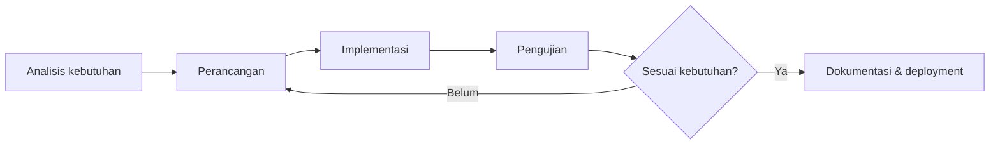

# Dokumen Pengembangan Aplikasi EventSphere

**Sistem Informasi Penyelenggaraan Event Berbasis Web**

| Atribut | Keterangan |
| --- | --- |
| Proyek | EventSphere |
| Kelompok | ErrorWeb — Kelas 5.2 |
| Penyusun | Ozra Ferdian (20105111054), Muhammed Ferdy (20105111058) |
| Dosen Pengampu | Zikrul Khalid |
| Versi dokumen | 1.0 |
| Tanggal | 17 November 2026 |
| Status | Final |
| Referensi | `docs/analisis-kebutuhan.md`, `docs/rancangan-sistem.md`, `docs/pengujian.md` |

---

## 1. Pendahuluan

### 1.1 Tujuan Dokumen

Dokumen ini menjelaskan proses dan hasil pengembangan aplikasi EventSphere: metodologi,
lingkungan kerja, struktur kode, implementasi setiap modul, keputusan teknis, kualitas kode,
pengujian, tantangan yang dihadapi, serta kesiapan deployment. Dokumen melengkapi
`docs/rancangan-sistem.md` yang berfokus pada rancangan, sedangkan dokumen ini berfokus pada
**bagaimana rancangan tersebut diwujudkan menjadi aplikasi yang berjalan**.

### 1.2 Ruang Lingkup

| Aspek | Cakupan |
| --- | --- |
| Metodologi | Pengembangan iteratif dengan lima tahap SDLC dan dokumentasi di setiap tahap |
| Basis kode | 16 controller aplikasi + 1 base controller, 4 model, 2 form request, 1 policy, 1 middleware, 34 view Blade |
| Rute | 40 rute publik dan terlindungi |
| Antarmuka | 24 halaman aplikasi, tema *Midnight Gold*, responsif |
| Pengujian | 58 test otomatis, 180 assertion, seluruhnya lulus |
| Deployment | Laravel Herd (lokal), Laravel Cloud (produksi) |

### 1.3 Dokumen Terkait

| Dokumen | Hubungan |
| --- | --- |
| `docs/analisis-kebutuhan.md` | Sumber kebutuhan fungsional F-01 s.d. F-32 dan aturan bisnis BR-01 s.d. BR-14 |
| `docs/rancangan-sistem.md` | Arsitektur, skema data, proses, dan rancangan antarmuka |
| `docs/diagram-mermaid.md` | DFD, ERD, use case, class, dan activity diagram |
| `DESIGN.md` | Style guide *Midnight Gold* |
| `docs/pengujian.md` | Skenario dan hasil pengujian |

---

## 2. Metodologi Pengembangan

### 2.1 Pendekatan

EventSphere dikembangkan dengan pendekatan **iteratif inkremental** yang mengadopsi alur
*Software Development Life Cycle* (SDLC): analisis kebutuhan, perancangan, implementasi,
pengujian, dan deployment. Setiap iterasi menghasilkan bagian aplikasi yang dapat dijalankan,
sehingga umpan balik dapat langsung diterapkan sebelum iterasi berikutnya.



Alasan pemilihan pendekatan:

1. Kebutuhan sudah cukup jelas sejak awal, tetapi detail tampilan dan aturan bisnis berkembang
   selama implementasi.
2. Setiap iterasi dapat didemonstrasikan, sehingga risiko salah arah lebih kecil.
3. Pengujian otomatis dapat ditambahkan bersamaan dengan fitur, bukan hanya di akhir proyek.

### 2.2 Tahapan dan Keluaran

| Tahap | Aktivitas | Keluaran |
| --- | --- | --- |
| 1. Analisis | Identifikasi aktor, kebutuhan fungsional/non-fungsional, aturan bisnis | `docs/analisis-kebutuhan.md` |
| 2. Perancangan | DFD, ERD, use case, class diagram, wireframe, design system | `docs/diagram-mermaid.md`, `DESIGN.md`, `docs/images/` |
| 3. Implementasi | Kode aplikasi per modul, migrasi, seeder, komponen UI | Aplikasi Laravel yang berjalan |
| 4. Pengujian | Test otomatis PHPUnit, black-box, UAT | `docs/pengujian.md`, 58 test |
| 5. Deployment | Build aset, migrasi, konfigurasi server | Aplikasi pada Herd/Laravel Cloud |

### 2.3 Riwayat Iterasi

| Iterasi | Fokus | Bukti pada repositori |
| --- | --- | --- |
| 1 | Kerangka Laravel, autentikasi, layout dasar | `f24849c initial commit` |
| 2 | Katalog event, detail, pendaftaran, dasbor per peran | `5c50007 initial commit` |
| 3 | Penyempurnaan tema *Midnight Gold* | `e7d90f6`, `8dd9eb5 ubah warna` |
| 4 | Analisis kebutuhan dan diagram | `93f2848 analisis kebutuhan dan mermaid` |
| 5 | Wireframe SVG 24 halaman | `1762869 sketsa svg` |
| 6 | Dokumen pengujian, 25 test baru, dokumen rancangan dan pengembangan | Tahap akhir |

---

## 3. Lingkungan Pengembangan

### 3.1 Perangkat Lunak

| Komponen | Versi | Keterangan |
| --- | --- | --- |
| PHP | 8.4.27 | Produksi mensyaratkan PHP 8.3+ |
| Laravel | 13.40.0 | Framework utama |
| Composer | 2.11.1 | Manajemen dependensi PHP |
| Node.js | 26.12.1 | Build aset frontend |
| Vite | 8 | *Dev server* dan bundler alternatif |
| Tailwind CSS | 4 | Design system dan utilitas CSS |
| PHPUnit | 12.5.12 | Test otomatis |
| Laravel Pint | 1.27 | Formatter PSR-12 |
| SQLite | bawaan PHP | Basis data lokal dan pengujian |
| Laravel Herd | terbaru | Web server lokal `http://eventsphere.test` |
| Visual Studio Code | terbaru | Editor dengan ekstensi Laravel Boost |

### 3.2 Struktur Dependensi

**Produksi (`composer.json`)**

| Paket | Fungsi |
| --- | --- |
| `laravel/framework` | Routing, Eloquent, Blade, validasi, sesi |
| `laravel/tinker` | REPL untuk debugging |

**Pengembangan**

| Paket | Fungsi |
| --- | --- |
| `phpunit/phpunit` | Test otomatis |
| `laravel/pint` | Formatter kode |
| `fakerphp/faker` | Data palsu untuk factory dan seeder |
| `laravel/boost` | Alat bantu pengembangan berbasis AI |
| `laravel/pail` | Pemantau log |
| `mockery/mockery` | Mocking pada test |
| `nunomaduro/collision` | Tampilan error CLI |

**Frontend (`package.json`)**

| Paket | Fungsi |
| --- | --- |
| `tailwindcss`, `@tailwindcss/vite`, `@tailwindcss/cli` | Utilitas CSS dan kompilasi |
| `vite`, `laravel-vite-plugin` | Bundler dan integrasi Laravel |
| `esbuild` | Bundling JavaScript pada script kustom |
| `lightningcss` | Minifikasi CSS |
| `concurrently` | Menjalankan beberapa proses sekaligus |

### 3.3 Perintah Pengembangan

| Kebutuhan | Perintah |
| --- | --- |
| Instalasi awal | `composer run setup` |
| Menjalankan server + aset | `composer run dev` |
| Build aset produksi | `npm run build` |
| Build dengan Vite | `npm run build:vite` |
| Migrasi dan data demo | `php artisan migrate --seed` |
| Menjalankan test | `php artisan test --compact` |
| Format kode | `vendor/bin/pint --dirty` |

`composer run setup` melakukan `composer install`, menyalin `.env`, membuat application key,
migrasi, `npm install`, dan build aset dalam satu perintah.

---

## 4. Struktur Kode

### 4.1 Struktur Direktori

```text
app/
├── Http/
│   ├── Controllers/
│   │   ├── Admin/            # Dasbor, event, kategori, pengguna, pendaftaran
│   │   ├── Organizer/        # Dasbor, event, pendaftar
│   │   ├── Participant/      # Dasbor, tiket
│   │   ├── AuthController.php
│   │   ├── DashboardController.php
│   │   ├── EventController.php
│   │   ├── HomeController.php
│   │   ├── ProfileController.php
│   │   └── RegistrationController.php
│   ├── Middleware/EnsureUserHasRole.php
│   └── Requests/             # StoreEventRequest, UpdateEventRequest
├── Models/                   # User, Category, Event, Registration
├── Policies/EventPolicy.php
├── EventStatus.php
├── RegistrationStatus.php
└── UserRole.php

database/
├── factories/                # UserFactory, CategoryFactory, EventFactory, RegistrationFactory
├── migrations/               # users, cache, jobs, categories, events, registrations
└── seeders/DatabaseSeeder.php

resources/
├── css/app.css               # Token dan komponen *Midnight Gold*
├── js/app.js
└── views/
    ├── admin/                # 9 view
    ├── auth/                 # 2 view
    ├── components/           # 5 komponen
    ├── errors/               # 403, 404
    ├── events/               # katalog dan detail
    ├── layouts/              # app, auth, dashboard
    ├── organizer/            # 7 view
    ├── participant/          # 3 view
    └── profile/              # 1 view

routes/web.php                # 40 rute
scripts/build-assets.mjs      # Build CSS/JS kustom
tests/Feature/                # 7 kelas test
```

### 4.2 Pembagian Tanggung Jawab

| Lapisan | Berkas | Tanggung jawab |
| --- | --- | --- |
| Routing | `routes/web.php` | Pemetaan URL, nama rute, middleware per grup |
| Middleware | `EnsureUserHasRole` | Menolak pengguna dengan peran tidak sesuai |
| Controller | `app/Http/Controllers` | Menerima request, memanggil validasi/policy/model, memilih view |
| Form Request | `app/Http/Requests` | Aturan validasi dan otorisasi form event |
| Policy | `app/Policies/EventPolicy` | Kepemilikan event untuk operasi baca/ubah/hapus |
| Model | `app/Models` | Relasi, cast, scope, helper domain |
| Enum | `app/*.php` | Status, label, dan kelas badge |
| View | `resources/views` | Markup Blade dan komponen |
| Data | `database/*` | Skema, factory, data demo |

Prinsip yang dipegang: **controller tipis**, aturan domain yang dapat dipakai ulang diletakkan
pada model (misalnya `seatsTaken`, `isSoldOut`, `hasFinished`, `uniqueSlug`), dan aturan
validasi/otorisasi form diletakkan pada Form Request atau Policy.

### 4.3 Konvensi Penulisan Kode

| Aspek | Konvensi | Contoh |
| --- | --- | --- |
| Penamaan kelas | PascalCase, deskriptif | `OrganizerEventManagementTest` |
| Penamaan metode | camelCase, predikat jelas | `isSoldOut`, `formattedPrice` |
| Nama rute | dot notation per modul | `organizer.events.registrants` |
| Enum | TitleCase pada case | `EventStatus::Published` |
| Tipe | Type hint dan return type eksplisit | `public function show(Event $event): View` |
| Dokumentasi | PHPDoc pada metode dan array shape | `@return array<string, mixed>` |
| Gaya | PSR-12 melalui Pint | Dijalankan sebelum commit |
| Bahasa UI | Indonesia | "Tiket Saya", "Daftar Event" |
| Bahasa kode | Inggris | `Registration`, `cancel`, `checked_in_at` |

---

## 5. Implementasi Modul

### 5.1 Autentikasi

**Berkas:** `app/Http/Controllers/AuthController.php`, `resources/views/auth/*`

| Fitur | Implementasi |
| --- | --- |
| Registrasi | Validasi `name`, `email` unik, `role`, `password` terkonfirmasi; organizer wajib `organization_name` |
| Login | `Auth::attempt()` dengan opsi *remember me*, regenerasi sesi |
| Logout | Invalidasi sesi dan regenerasi token CSRF |
| Pengalihan | `DashboardController` memilih dasbor berdasarkan `UserRole` |

Potongan logika registrasi:

```php
$validated = $request->validate([
    'name' => ['required', 'string', 'max:120'],
    'email' => ['required', 'string', 'email', 'max:255', Rule::unique(User::class)],
    'role' => ['required', Rule::in([UserRole::Participant->value, UserRole::Organizer->value])],
    'organization_name' => ['required_if:role,'.UserRole::Organizer->value, 'nullable', 'string', 'max:120'],
    'password' => ['required', 'string', 'min:8', 'confirmed'],
]);

$user = User::create($validated);
Auth::login($user);
$request->session()->regenerate();
```

Peran `admin` tidak dapat dipilih saat registrasi; akun admin hanya dibuat melalui seeder
atau diubah oleh admin lain.

### 5.2 Profil Pengguna

**Berkas:** `app/Http/Controllers/ProfileController.php`, `resources/views/profile/edit.blade.php`

- Pengguna dapat mengubah nama, email, telepon, nama organisasi, dan bio.
- Email divalidasi unik dengan pengecualian ID pengguna sendiri (`Rule::unique('users')->ignore($user->id)`).
- Avatar divalidasi dengan aturan `image` dan ukuran maksimum 2 MB, disimpan ke disk `public`,
  dan avatar lama dihapus untuk menghindari berkas yatim.
- Bila tidak ada avatar, `User::avatarUrl()` menghasilkan placeholder SVG berisi inisial nama,
  sehingga tidak ada permintaan gambar eksternal.

### 5.3 Beranda dan Katalog Publik

**Berkas:** `HomeController`, `EventController`, `resources/views/home.blade.php`, `events/*`

| Halaman | Query utama |
| --- | --- |
| Beranda | Event unggulan mendatang (3), event mendatang (6), kategori dengan jumlah event |
| Katalog | `visible()->upcoming()` + filter `q`, `category`, `city`, `sort` |
| Detail | Route model binding berdasarkan `slug`, 404 bila tidak publik |

Pencarian mencakup judul, lokasi, kota, dan deskripsi. Pengurutan yang tersedia: `soonest`,
`latest`, `cheapest`, dan `popular` (berdasarkan jumlah pendaftaran aktif). Semua daftar
menggunakan `withCount` untuk menghindari N+1 saat menampilkan sisa kuota.

```php
$events = Event::query()
    ->visible()
    ->upcoming()
    ->with(['category', 'organizer'])
    ->withCount(['registrations as active_registrations_count' => fn ($query) =>
        $query->whereIn('status', ['pending', 'confirmed', 'attended'])])
    ->when($filters['q'] ?? null, fn ($query, string $search) =>
        $query->where(fn ($query) => $query
            ->where('title', 'like', "%{$search}%")
            ->orWhere('venue', 'like', "%{$search}%")
            ->orWhere('city', 'like', "%{$search}%")))
    ->paginate(9)
    ->withQueryString();
```

### 5.4 Pendaftaran Event dan Tiket Digital

**Berkas:** `RegistrationController`, `Participant\RegistrationController`, `Registration`

Alur pendaftaran menerapkan aturan bisnis secara berurutan:

1. Hanya pengguna berperan peserta yang boleh mendaftar (`abort_unless(..., 403)`).
2. Event harus berstatus `published` atau `completed` (selain itu 404).
3. Event yang sudah berakhir ditolak dengan pesan kesalahan.
4. Kuota diperiksa melalui `seatsTaken()` yang menghitung status `pending`, `confirmed`, dan `attended`.
5. Pendaftaran ganda dicegah di level aplikasi **dan** di level basis data melalui
   `UNIQUE (event_id, user_id)`.
6. Pendaftaran yang pernah dibatalkan diaktifkan kembali, bukan dibuat baru.
7. Kode tiket dibuat otomatis pada event `creating` model:

```php
static::creating(function (Registration $registration): void {
    $registration->ticket_code ??= 'EVS-'.Str::upper(Str::random(8));
});
```

Pembatalan hanya diizinkan sebelum `starts_at` dan hanya untuk pendaftaran yang belum
berstatus `cancelled`. Peserta hanya dapat membuka tiketnya sendiri; kepemilikan diperiksa
dengan `abort_unless($registration->user_id === $request->user()->id, 403)`.

### 5.5 Dasbor Peserta

**Berkas:** `Participant\DashboardController`, `Participant\RegistrationController`

| Data | Sumber |
| --- | --- |
| Total pendaftaran | seluruh registrasi pengguna |
| Event mendatang | registrasi dengan event `ends_at` di masa depan |
| Sudah hadir | status `attended` |
| Dibatalkan | status `cancelled` |
| Tiket mendatang | 5 registrasi terdekat beserta kode tiket |
| Rekomendasi | event terbit mendatang yang belum diikuti |

Halaman tiket menampilkan kode, status, jadwal, lokasi, penyelenggara, dan visual QR.
Tiket dapat dicetak melalui `window.print()` dengan gaya cetak khusus.

### 5.6 Pengelolaan Event oleh Penyelenggara

**Berkas:** `Organizer\EventController`, `Organizer\RegistrationController`,
`StoreEventRequest`, `UpdateEventRequest`, `EventPolicy`

| Operasi | Aturan |
| --- | --- |
| Daftar event | Hanya `organizedEvents()` milik pengguna, dengan filter kata kunci dan status |
| Buat | `authorize('create', Event::class)`, status awal `draft` atau `published` |
| Ubah | `EventPolicy::update` memastikan kepemilikan |
| Hapus | `EventPolicy::delete`; pendaftaran terkait ikut terhapus melalui FK cascade |
| Poster | Unggah gambar opsional, disimpan pada disk `public` |
| Pendaftar | Filter status dan pencarian kode tiket/nama/email, paginasi 15 |
| Check-in | Status `attended` mengisi `checked_in_at`, status lain mengosongkannya |

Validasi form event mencakup: judul maksimum 120 karakter, deskripsi 20–5.000 karakter,
`ends_at` setelah `starts_at`, kapasitas 1–100.000, harga ≥ 0, serta status yang diizinkan
untuk organizer (`draft`, `published`, `cancelled`).

### 5.7 Administrasi Sistem

**Berkas:** `Admin\DashboardController`, `Admin\EventController`, `Admin\CategoryController`,
`Admin\UserController`, `Admin\RegistrationController`

| Modul | Fitur |
| --- | --- |
| Dasbor | Statistik pengguna, event, pendaftaran, pendapatan, event terbaru, kategori teratas |
| Event | Daftar semua event, filter status, detail, ubah status, hapus |
| Kategori | CRUD penuh dengan slug otomatis dan warna badge |
| Pengguna | Daftar dengan filter peran/pencarian, ubah peran, hapus akun |
| Pendaftaran | Daftar lintas event dengan filter status dan pencarian |

Aturan perlindungan akun:

- Admin tidak dapat menurunkan perannya sendiri.
- Admin tidak dapat menghapus akunnya sendiri.
- Perubahan peran menjadi `organizer` mengisi `organization_name` bila masih kosong.
- Penghapusan kategori menggunakan `nullOnDelete`, sehingga event tetap ada dengan
  `category_id = null`.

### 5.8 Komponen Antarmuka Bersama

| Komponen | Berkas | Kegunaan |
| --- | --- | --- |
| Layout publik | `layouts/app.blade.php` | Navigasi, footer, flash message |
| Layout autentikasi | `layouts/auth.blade.php` | Dua kolom dengan panel ilustrasi |
| Layout dasbor | `layouts/dashboard.blade.php` | Sidebar per peran, topbar, menu pengguna |
| Kartu event | `components/event-card.blade.php` | Poster, kategori, judul, jadwal, harga, kuota |
| Kartu statistik | `components/stat-card.blade.php` | Angka dan label pada dasbor |
| Flash | `components/flash.blade.php` | Pesan sukses/error dari session |
| QR tiket | `components/ticket-qr.blade.php` | Visual QR deterministik dari kode tiket |
| Latar ambien | `components/ambient-background.blade.php` | Ornamen latar halaman publik |

---

## 6. Implementasi Basis Data

### 6.1 Migrasi

| Berkas migrasi | Tabel | Catatan |
| --- | --- | --- |
| `0001_01_01_000000_create_users_table.php` | `users`, `password_reset_tokens`, `sessions` | Peran default `participant` |
| `0001_01_01_000001_create_cache_table.php` | `cache`, `cache_locks` | Cache bawaan Laravel |
| `0001_01_01_000002_create_jobs_table.php` | `jobs`, `job_batches`, `failed_jobs` | Antrean belum digunakan |
| `2026_11_09_150954_create_categories_table.php` | `categories` | Slug unik, warna default |
| `2026_11_09_150955_create_events_table.php` | `events` | FK organizer cascade, kategori set null, indeks status + jadwal |
| `2026_11_09_150956_create_registrations_table.php` | `registrations` | Kode tiket unik, unique pasangan event–user |

### 6.2 Model dan Cast

| Model | Cast penting | Helper domain |
| --- | --- | --- |
| `User` | `role` → `UserRole`, `password` → `hashed` | `isAdmin`, `isOrganizer`, `isParticipant`, `avatarUrl` |
| `Category` | - | `events()` |
| `Event` | `status` → `EventStatus`, `starts_at`/`ends_at` → datetime, `price` → decimal | `seatsTaken`, `seatsRemaining`, `isSoldOut`, `isFree`, `hasFinished`, `uniqueSlug`, scope `visible`/`upcoming`/`featured` |
| `Registration` | `status` → `RegistrationStatus`, `checked_in_at` → datetime | `event()`, `user()`, generator `ticket_code` |

Atribut massal dilindungi dengan atribut PHP `#[Fillable([...])]`, dan `password`/`remember_token`
disembunyikan dengan `#[Hidden([...])]`.

### 6.3 Factory dan Seeder

| Berkas | Isi |
| --- | --- |
| `UserFactory` | State `admin()`, `organizer()`, `participant()`; kata sandi default `password` |
| `CategoryFactory` | Nama unik, slug, warna |
| `EventFactory` | Status acak, jadwal, kapasitas, harga, poster, relasi organizer/kategori |
| `RegistrationFactory` | Status acak, kode tiket, relasi event/user |
| `DatabaseSeeder` | 30 pengguna, 8 kategori, 15 event, 162 pendaftaran |

Data seeder dirancang agar setiap peran memiliki cukup data untuk demonstrasi: 12 event
terbit, 2 selesai, 1 draf, serta pendaftaran pada keempat status.

---

## 7. Implementasi Frontend

### 7.1 Design System

Tema *Midnight Gold* didefinisikan sebagai token Tailwind 4 di `resources/css/app.css`:

| Kelompok | Token | Nilai utama |
| --- | --- | --- |
| Permukaan | `canvas`, `surface`, `surface-2`, `line` | `#09090B`, `#18181B`, `#1F1F23`, `#27272A` |
| Teks | `ink`, `muted`, `faint` | `#FAFAFA`, `#A1A1AA`, `#71717A` |
| Aksen | `accent`, `accent-hover`, `accent-soft` | `#FBBF24`, `#F59E0B`, `#FCD34D` |
| Bahaya | `danger` | `#E11D48` |

Tipografi memakai **Montserrat** untuk judul/angka dan **Inter** untuk teks isi, dimuat
melalui plugin font `laravel-vite-plugin`. Tidak ada warna biru/ungu atau efek neon.

### 7.2 Build Aset

Proyek menyediakan dua jalur build:

| Jalur | Perintah | Keterangan |
| --- | --- | --- |
| Kustom | `npm run build` | `scripts/build-assets.mjs` memakai Tailwind Node API, `lightningcss`, dan `esbuild` |
| Vite | `npm run build:vite` | Konfigurasi standar `vite.config.js` |

Script kustom memindai view Blade, JavaScript, dan file PHP untuk mengumpulkan kelas Tailwind,
lalu menulis hasil ke `public/build` beserta manifest. Pendekatan ini dipilih karena lingkungan
Windows pengembangan memblokir binding native Tailwind; script mengaktifkan fallback WASI
(`NAPI_RS_FORCE_WASI`) agar kompilasi tetap berjalan.

### 7.3 Responsivitas dan Aksesibilitas

- Grid katalog: 1 kolom (ponsel), 2 kolom (tablet), 3 kolom (desktop).
- Sidebar dasbor dapat dibuka/tutup pada layar kecil; tabel dapat digulir horizontal.
- Setiap input memiliki label, pesan error di dekat field, dan ring fokus.
- Tombol destruktif memakai konfirmasi sebelum mengirim form.
- Gambar poster dan avatar memiliki teks alternatif.
- Halaman 403 dan 404 disediakan khusus agar pengguna tidak melihat halaman error bawaan.

---

## 8. Implementasi Keamanan

| Kontrol | Implementasi | Berkas |
| --- | --- | --- |
| Autentikasi sesi | `Auth::attempt`, regenerasi sesi, invalidasi saat logout | `AuthController` |
| Otorisasi peran | Alias middleware `role` | `EnsureUserHasRole`, `bootstrap/app.php` |
| Otorisasi kepemilikan | `$this->authorize('view', $event)` dan pengecekan `user_id` | `EventPolicy`, controller organizer/peserta |
| Validasi input | Form Request dan `$request->validate` | `StoreEventRequest`, seluruh controller |
| CSRF | Middleware `web` dan `@csrf` pada setiap form | Blade |
| XSS | Escaping `{{ }}`; tidak ada `{!! !!}` pada data pengguna | Seluruh view |
| Mass assignment | `#[Fillable]` per model | Model |
| Hashing kata sandi | Cast `hashed` + bcrypt | `User` |
| Unggah berkas | Validasi tipe, ukuran, dan nama acak | `ProfileController`, `Organizer\EventController` |
| Integritas data | Foreign key, unique constraint, transaksi implisit | Migrasi |
| Enumerasi status | `Rule::enum` pada input status/peran | Form Request, controller admin |

Catatan keterbatasan: belum ada *rate limiting* login, verifikasi email, reset kata sandi,
dan audit log. Rencana penanganannya tercatat pada `docs/pengujian.md` bagian 10 dan
`docs/rancangan-sistem.md` bagian 7.

---

## 9. Kualitas Kode

### 9.1 Standar dan Alat

| Aspek | Alat/Standar | Penerapan |
| --- | --- | --- |
| Gaya kode | Laravel Pint (PSR-12) | `vendor/bin/pint --dirty` sebelum commit |
| Tipe | Type hint, return type, PHPDoc | Seluruh metode publik |
| Struktur | Controller–Request–Policy–Model | Konsisten di semua modul |
| Query | Eager loading dan `withCount` | Katalog, dasbor, daftar pendaftar |
| Penamaan | Deskriptif, bahasa Inggris untuk kode | `active_registrations_count`, `hasFinished` |
| Komentar | PHPDoc, bukan komentar inline berlebihan | Seluruh kelas |

### 9.2 Hasil Pemeriksaan

```text
vendor/bin/pint --dirty --format agent
passed
```

Tidak ada pelanggaran gaya kode pada berkas yang diubah. Struktur direktori mengikuti
konvensi Laravel, sehingga pengembang baru dapat menavigasi proyek tanpa lapisan abstraksi
tambahan.

---

## 10. Pengujian Selama Pengembangan

### 10.1 Strategi

| Level | Alat | Fokus |
| --- | --- | --- |
| Feature | PHPUnit + `RefreshDatabase` | Alur HTTP, otorisasi, validasi, efek ke basis data |
| Unit | PHPUnit | Konfigurasi dasar aplikasi |
| Black-box | Browser manual | Tampilan, navigasi, pesan kesalahan |
| UAT | Simulasi peran | Skenario peserta, penyelenggara, admin |

Setiap test menggunakan basis data SQLite in-memory dan factory, sehingga tidak bergantung
pada data demo dan dapat dijalankan berulang.

### 10.2 Sebaran Test

| Kelas test | Jumlah | Cakupan |
| --- | ---: | --- |
| `AuthenticationTest` | 8 | Registrasi, login, logout, email duplikat |
| `EventRegistrationTest` | 12 | Pendaftaran, kuota, tiket, pembatalan, aktivasi ulang |
| `PublicPagesTest` | 6 | Beranda, katalog, filter, detail, visibilitas |
| `RoleAccessTest` | 10 | Middleware peran, kepemilikan, check-in |
| `AdminManagementTest` | 10 | Kategori, pengguna, peran, moderasi event |
| `OrganizerEventManagementTest` | 6 | CRUD event, validasi jadwal, pencarian pendaftar |
| `ProfileTest` | 5 | Profil, email unik, avatar, tamu |
| `ExampleTest` | 1 | Konfigurasi aplikasi |
| **Total** | **58** | **180 assertion** |

### 10.3 Hasil

```text
php artisan test --compact
passed · 58 test · 180 assertion
```

Rincian skenario, matriks keterlacakan F-01 s.d. F-32, dan catatan cacat tersedia pada
`docs/pengujian.md`.

---

## 11. Tantangan dan Solusi

| No | Tantangan | Dampak | Solusi |
| ---: | --- | --- | --- |
| 1 | Binding native Tailwind gagal pada Windows (Application Control) | `npm run build` gagal | Script kustom mengaktifkan fallback WASI dan memakai `lightningcss`/`esbuild` |
| 2 | Slug event harus unik tetapi judul bisa sama | Terjadi duplikasi URL | `Event::uniqueSlug()` menambahkan sufiks angka secara berulang |
| 3 | Pendaftaran ganda dapat lolos jika hanya dicek di aplikasi | Data ganda | Kombinasi pengecekan aplikasi dan `UNIQUE (event_id, user_id)` |
| 4 | Peserta yang membatalkan lalu mendaftar lagi | Dua baris pendaftaran | Pendaftaran lama diaktifkan kembali (`status = confirmed`) |
| 5 | Kuota harus konsisten di katalog dan dasbor | Angka kuota berbeda | `withCount` status aktif + helper `seatsTaken()` yang memakai atribut hitungan bila tersedia |
| 6 | Otorisasi kepemilikan event tersebar | Risiko penyelenggara mengubah event lain | `EventPolicy` sebagai satu-satunya sumber keputusan, dipanggil controller dan Form Request |
| 7 | Data tanggal tampil berbeda antara server dan UI | Jadwal membingungkan | Cast `datetime`, format konsisten `d M Y`, dan zona waktu aplikasi |
| 8 | Test bergantung pada data seeder | Hasil tidak deterministik | `RefreshDatabase` + factory dengan state per peran |
| 9 | Aset tidak muncul setelah perubahan | UI menampilkan versi lama | Build ulang `npm run build`; manifest dibaca oleh helper aset |
| 10 | Halaman error bawaan tidak sesuai tema | Pengalaman pengguna tidak konsisten | View `errors/403` dan `errors/404` kustom |

---

## 12. Riwayat Perubahan

| Commit | Tanggal | Ringkasan |
| --- | --- | --- |
| `f24849c` | 10 Nov 2026 | Kerangka awal Laravel dan konfigurasi proyek |
| `5c50007` | 11 Nov 2026 | Modul utama: autentikasi, katalog, pendaftaran, dasbor |
| `e7d90f6` | 11 Nov 2026 | Penyesuaian warna antarmuka |
| `8dd9eb5` | 11 Nov 2026 | Penyempurnaan palet *Midnight Gold* |
| `93f2848` | 16 Nov 2026 | Analisis kebutuhan dan diagram Mermaid |
| `1762869` | 17 Nov 2026 | Wireframe SVG 24 halaman |
| — | 17 Nov 2026 | Dokumen pengujian, 25 test baru, dokumen rancangan dan pengembangan |

---

## 13. Kesiapan Deployment

### 13.1 Checklist Lokal

| Langkah | Perintah | Status |
| --- | --- | :---: |
| Dependensi PHP | `composer install --no-dev --optimize-autoloader` | Siap |
| Kunci aplikasi | `php artisan key:generate --force` | Siap |
| Migrasi | `php artisan migrate --force` | Siap |
| Data demo | `php artisan db:seed --force` | Opsional |
| Tautan storage | `php artisan storage:link` | Siap |
| Build aset | `npm ci && npm run build` | Siap |
| Cache konfigurasi | `php artisan optimize` | Siap |
| Pengujian | `php artisan test --compact` | 58 lulus |

### 13.2 Rencana Laravel Cloud

| Komponen | Rencana |
| --- | --- |
| Runtime | PHP 8.4 |
| Basis data | MySQL/PostgreSQL terkelola |
| Build | `npm ci && npm run build`, lalu `php artisan migrate --force` |
| Storage | Object storage untuk poster dan avatar (filesystem cloud bersifat sementara) |
| Variabel lingkungan | `APP_ENV=production`, `APP_KEY`, `APP_URL`, `APP_DEBUG=false`, kredensial DB, disk storage |
| Queue | `sync` (belum ada job) |
| Scheduler | Tidak ada task terjadwal |
| Mail | `log` untuk demo atau SMTP produksi |

Perubahan yang diperlukan sebelum go-live:

1. Ganti disk unggahan ke object storage dan sesuaikan `posterUrl()`/`avatarUrl()`.
2. Aktifkan HTTPS dan `APP_DEBUG=false`.
3. Tambahkan `throttle` pada rute login/registrasi.
4. Jalankan migrasi dan seeder melalui proses rilis, bukan manual.

---

## 14. Rencana Pengembangan Lanjutan

| Prioritas | Fitur | Alasan |
| --- | --- | --- |
| Tinggi | *Rate limiting* login dan reset kata sandi | Keamanan akun |
| Tinggi | QR tiket standar + halaman pemindaian panitia | Validasi kehadiran lebih cepat |
| Sedang | Ekspor laporan CSV/PDF | Kebutuhan operasional penyelenggara |
| Sedang | Notifikasi email transaksional | Konfirmasi dan pengingat event |
| Sedang | Object storage produksi | Kesiapan Laravel Cloud |
| Rendah | Payment gateway | Di luar lingkup versi akademik (BR-14) |
| Rendah | Audit log dan pengujian beban | Kesiapan skala besar |

---

## 15. Penutup

EventSphere telah diimplementasikan sesuai rancangan: monolitik Laravel dengan Blade,
empat entitas domain, pembatasan akses berlapis, dan antarmuka *Midnight Gold* yang responsif.
Seluruh kebutuhan fungsional F-01 s.d. F-32 tertelusuri ke implementasi dan bukti pengujian,
dengan **58 test otomatis lulus tanpa kegagalan**. Dokumen ini bersama `docs/rancangan-sistem.md`
dan `docs/pengujian.md` membentuk rangkaian dokumentasi lengkap dari analisis hingga kesiapan
deployment.
