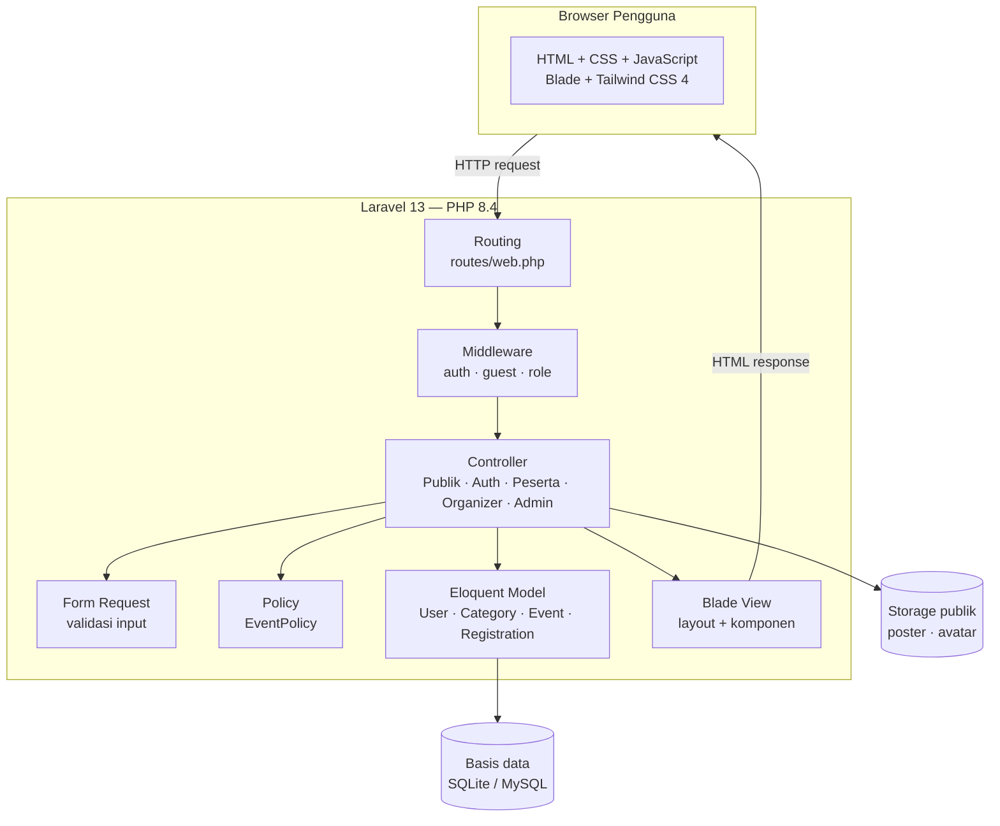
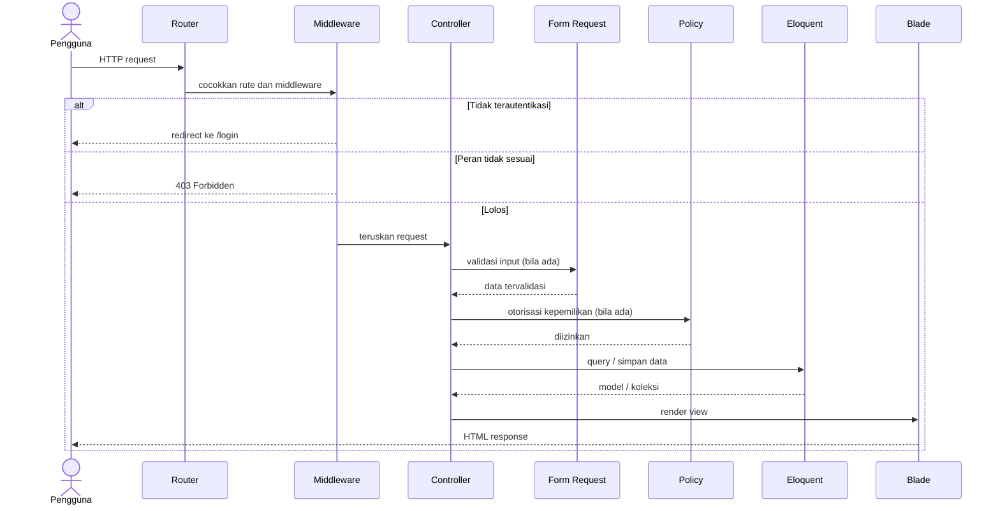
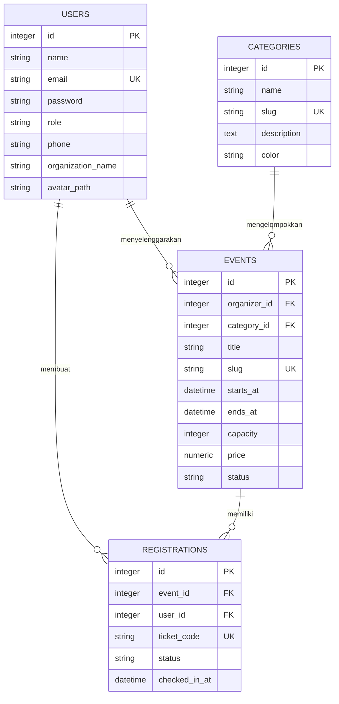
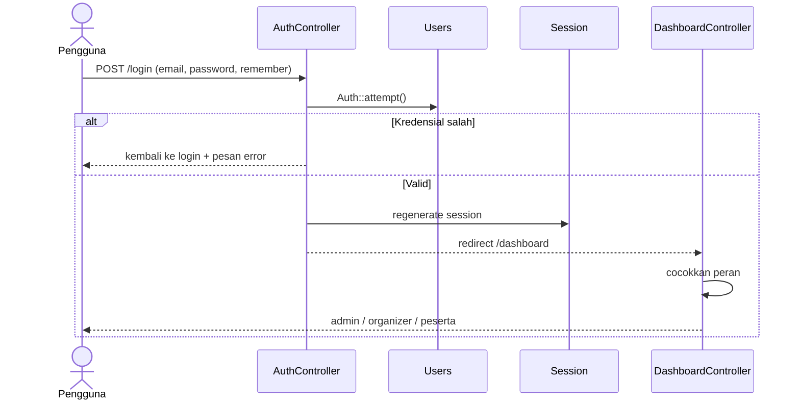
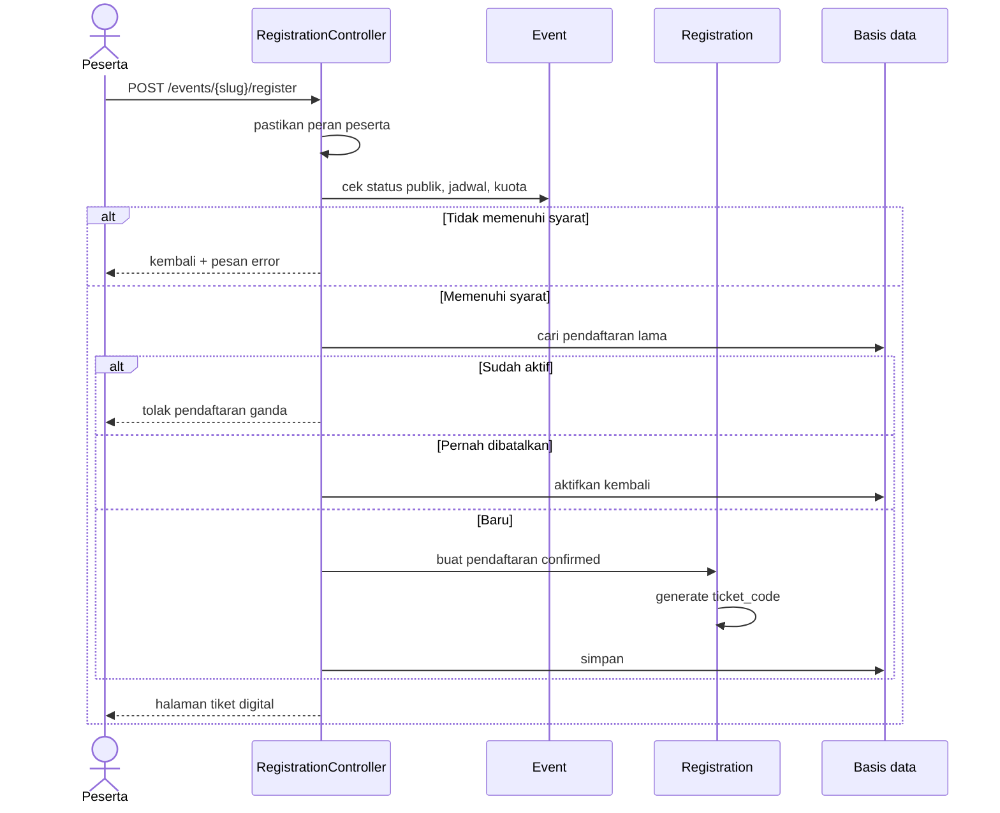
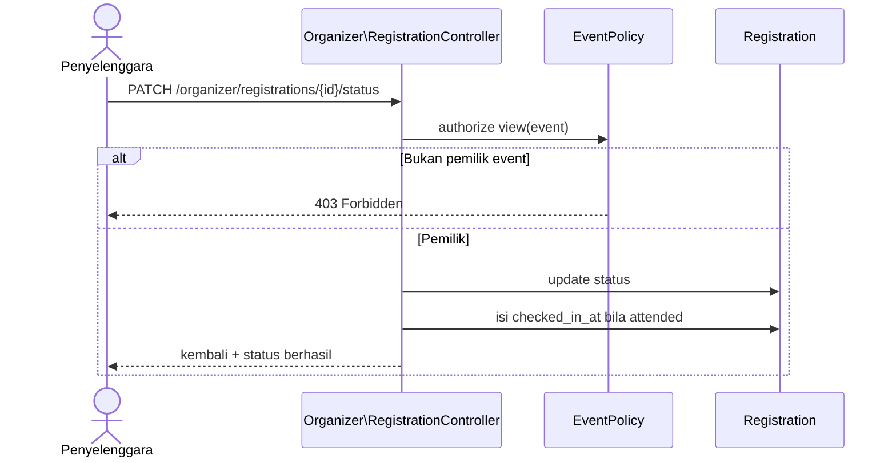
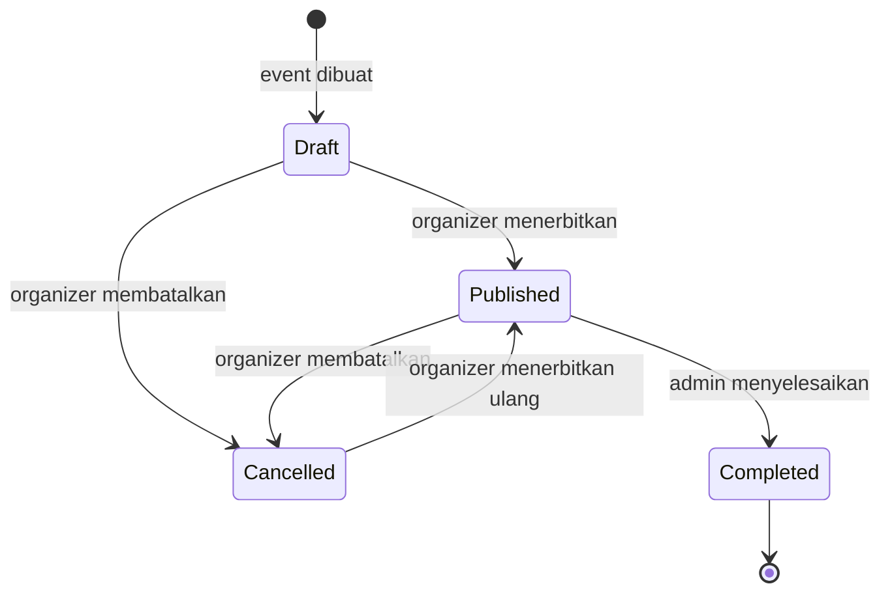
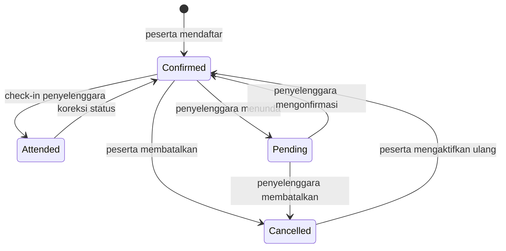
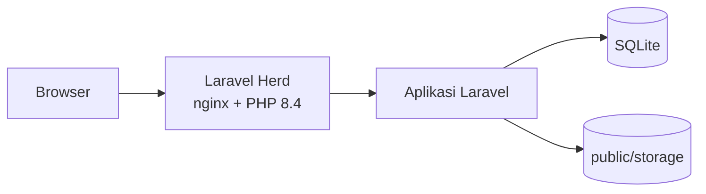
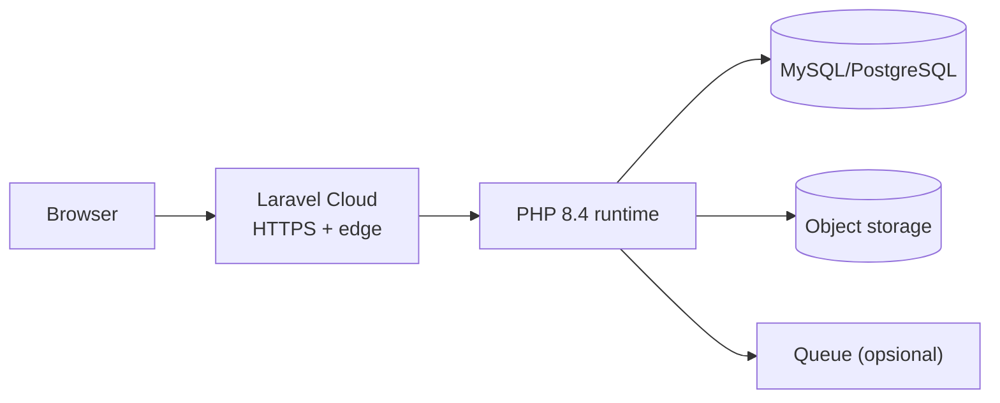

# Dokumen Rancangan Sistem EventSphere

**Sistem Informasi Penyelenggaraan Event Berbasis Web**

| Atribut | Keterangan |
| --- | --- |
| Proyek | EventSphere |
| Kelompok | ErrorWeb — Kelas 5.2 |
| Penyusun | Ozra Ferdian (20105111054), Muhammed Ferdy (20105111058) |
| Dosen Pengampu | Zikrul Khalid |
| Versi dokumen | 1.0 |
| Tanggal | 17 November 2026 |
| Status | Final |
| Referensi | `docs/analisis-kebutuhan.md`, `docs/diagram-mermaid.md`, `docs/drawio/` |

---

## 1. Pendahuluan

### 1.1 Tujuan Dokumen

Dokumen ini menjelaskan rancangan sistem EventSphere pada tingkat arsitektur, modul,
basis data, proses, antarmuka, keamanan, dan deployment. Dokumen menjadi acuan implementasi
dan penghubung antara analisis kebutuhan dengan kode aplikasi.

### 1.2 Ruang Lingkup

| Aspek | Cakupan |
| --- | --- |
| Arsitektur | Aplikasi monolitik *server-side rendered* dengan pola MVC berlapis |
| Modul | Autentikasi, katalog publik, pendaftaran, pengelolaan event, administrasi, profil |
| Basis data | Empat tabel domain: `users`, `categories`, `events`, `registrations` |
| Antarmuka | 24 halaman, tema gelap *Midnight Gold*, responsif |
| Keamanan | Autentikasi sesi, RBAC, policy kepemilikan, validasi, CSRF |
| Deployment | Laravel Herd (lokal) dan Laravel Cloud (produksi) |

### 1.3 Dokumen Terkait

| Dokumen | Isi |
| --- | --- |
| `docs/analisis-kebutuhan.md` | 32 kebutuhan fungsional, 11 non-fungsional, 14 aturan bisnis |
| `docs/diagram-mermaid.md` | DFD konteks, DFD level 0, ERD, use case, class, activity diagram |
| `docs/drawio/` | Sumber diagram yang dapat diedit |
| `DESIGN.md` | Style guide *Midnight Gold* |
| `docs/pengujian.md` | Rencana, skenario, dan hasil pengujian |

---

## 2. Arsitektur Sistem

### 2.1 Gaya Arsitektur

EventSphere menggunakan **monolitik modular** dengan **server-side rendering**. Seluruh
halaman dirender oleh Blade di server, lalu dikirim sebagai HTML ke browser. Pendekatan ini
dipilih karena:

1. Sederhana untuk proyek akademik dan mudah dipahami tim.
2. Tidak memerlukan API terpisah atau proses build frontend yang kompleks.
3. Lebih aman terhadap XSS karena Blade melakukan escaping otomatis.
4. Waktu muat awal cepat dan ramah SEO untuk halaman katalog publik.

Lapisan aplikasi:

| Lapisan | Tanggung jawab | Contoh |
| --- | --- | --- |
| Presentasi | Render HTML, komponen UI, navigasi | `resources/views`, Tailwind CSS |
| Aplikasi | Routing, validasi, orkestrasi request | `routes/web.php`, Controller, Form Request |
| Domain | Aturan bisnis, status, otorisasi | Model, Enum, `EventPolicy` |
| Data | Skema, relasi, seeding | Migrasi, Eloquent, Factory, Seeder |

### 2.2 Diagram Arsitektur

### 2.3 Komponen Utama

| Komponen | Lokasi | Tanggung jawab |
| --- | --- | --- |
| Routing | `routes/web.php` | 40 rute publik dan terlindungi |
| Middleware peran | `app/Http/Middleware/EnsureUserHasRole.php` | Menolak akses lintas peran (403) |
| Controller publik | `HomeController`, `EventController` | Beranda, katalog, detail event |
| Controller autentikasi | `AuthController` | Login, registrasi, logout |
| Controller peserta | `Participant\*` | Dasbor, tiket, pembatalan |
| Controller penyelenggara | `Organizer\*` | Dasbor, event, pendaftar |
| Controller admin | `Admin\*` | Dasbor, kategori, event, pengguna, pendaftaran |
| Form Request | `StoreEventRequest`, `UpdateEventRequest` | Validasi data event |
| Policy | `EventPolicy` | Kepemilikan event |
| Model | `User`, `Category`, `Event`, `Registration` | Relasi dan aturan domain |
| Enum | `UserRole`, `EventStatus`, `RegistrationStatus` | Status dan label |
| View | `resources/views` | 24 halaman aplikasi + komponen |
| Aset | `resources/css/app.css` | Design system *Midnight Gold* |

### 2.4 Alur Request

### 2.5 Lingkungan Runtime

| Komponen | Lokal | Produksi |
| --- | --- | --- |
| Web server | nginx Laravel Herd | Laravel Cloud |
| PHP | 8.4 | 8.4 |
| Basis data | SQLite | MySQL/PostgreSQL terkelola |
| Cache/sesi | file | database/Redis |
| Storage | disk `public` | object storage |
| Build aset | `npm run build` | `npm ci && npm run build` |

---

## 3. Rancangan Modul

### 3.1 Peta Modul

| Modul | Aktor | Prefix rute | Controller | View utama |
| --- | --- | --- | --- | --- |
| Beranda & katalog | Publik | `/`, `/events` | `HomeController`, `EventController` | `home`, `events/*` |
| Autentikasi | Tamu | `/login`, `/register` | `AuthController` | `auth/*` |
| Profil | Semua pengguna | `/profile` | `ProfileController` | `profile/edit` |
| Dasbor peserta | Peserta | `/peserta`, `/my-registrations` | `Participant\*` | `participant/*` |
| Pengelolaan event | Penyelenggara | `/organizer` | `Organizer\*` | `organizer/*` |
| Administrasi | Admin | `/admin` | `Admin\*` | `admin/*` |

### 3.2 Matriks Hak Akses

| Fitur | Tamu | Peserta | Penyelenggara | Admin |
| --- | :---: | :---: | :---: | :---: |
| Beranda, katalog, detail event | ✓ | ✓ | ✓ | ✓ |
| Registrasi dan login | ✓ | - | - | - |
| Profil | - | ✓ | ✓ | ✓ |
| Pendaftaran event dan tiket | - | ✓ | - | - |
| Pembatalan pendaftaran | - | ✓ | - | - |
| CRUD event sendiri | - | - | ✓ | - |
| Daftar pendaftar dan check-in | - | - | ✓ | - |
| Kategori, pengguna, moderasi event | - | - | - | ✓ |
| Seluruh pendaftaran dan statistik global | - | - | - | ✓ |

### 3.3 Rancangan Rute dan Middleware

| Grup | Middleware | Rute | Jumlah |
| --- | --- | --- | ---: |
| Publik | `web` | `/`, `/events`, `/events/{slug}` | 3 |
| Tamu | `web`, `guest` | `/login`, `/register` | 4 |
| Terautentikasi | `web`, `auth` | `/logout`, `/dashboard`, `/profile`, pendaftaran event, tiket peserta | 8 |
| Admin | `web`, `auth`, `role:admin` | `/admin/*` | 15 |
| Penyelenggara | `web`, `auth`, `role:organizer` | `/organizer/*` | 9 |
| Peserta | `web`, `auth`, `role:participant` | `/peserta` | 1 |

### 3.4 Navigasi per Peran

| Peran | Menu utama |
| --- | --- |
| Publik | Beranda, Jelajahi Event, Masuk, Daftar |
| Peserta | Dasbor, Tiket Saya, Profil, Keluar |
| Penyelenggara | Dasbor, Event Saya, Buat Event, Profil, Keluar |
| Admin | Dasbor, Event, Kategori, Pengguna, Pendaftaran, Profil, Keluar |

---

## 4. Rancangan Basis Data

### 4.1 Prinsip Perancangan

1. Nama tabel jamak dan kolom *snake_case*.
2. Setiap tabel memiliki primary key `id` dan timestamp.
3. Relasi dijaga dengan foreign key dan aksi `cascade`/`nullOnDelete` yang eksplisit.
4. Nilai unik dijaga di level basis data, bukan hanya validasi aplikasi.
5. Status disimpan sebagai string yang dipetakan ke enum PHP.
6. Indeks komposit ditambahkan pada kolom yang sering difilter bersama.

### 4.2 Relasi Antar Entitas

### 4.3 Spesifikasi Tabel

#### 4.3.1 `users`

| Kolom | Tipe | Null | Constraint | Keterangan |
| --- | --- | :---: | --- | --- |
| `id` | integer | tidak | PK, auto increment | Identifier pengguna |
| `name` | varchar | tidak | - | Nama lengkap |
| `email` | varchar | tidak | UNIQUE | Kredensial login |
| `email_verified_at` | datetime | ya | - | Disiapkan untuk verifikasi email |
| `password` | varchar | tidak | - | Hash kata sandi |
| `remember_token` | varchar | ya | - | Token *remember me* |
| `role` | varchar | tidak | default `participant` | `admin`, `organizer`, `participant` |
| `phone` | varchar(30) | ya | - | Nomor telepon |
| `organization_name` | varchar(120) | ya | - | Wajib untuk organizer |
| `bio` | text | ya | - | Profil singkat |
| `avatar_path` | varchar | ya | - | Path avatar di disk publik |
| `created_at`, `updated_at` | datetime | ya | - | Timestamp |

#### 4.3.2 `categories`

| Kolom | Tipe | Null | Constraint | Keterangan |
| --- | --- | :---: | --- | --- |
| `id` | integer | tidak | PK | Identifier kategori |
| `name` | varchar(80) | tidak | - | Nama kategori |
| `slug` | varchar(255) | tidak | UNIQUE | URL kategori |
| `description` | text | ya | - | Deskripsi |
| `color` | varchar(7) | tidak | default `#6366f1` | Warna badge |
| `icon` | varchar | ya | - | Ikon opsional |
| `created_at`, `updated_at` | datetime | ya | - | Timestamp |

#### 4.3.3 `events`

| Kolom | Tipe | Null | Constraint | Keterangan |
| --- | --- | :---: | --- | --- |
| `id` | integer | tidak | PK | Identifier event |
| `organizer_id` | integer | tidak | FK `users`, cascade | Pemilik event |
| `category_id` | integer | ya | FK `categories`, set null | Kategori |
| `title` | varchar(120) | tidak | - | Judul event |
| `slug` | varchar(255) | tidak | UNIQUE | URL event |
| `description` | text | tidak | - | Deskripsi |
| `venue` | varchar(160) | tidak | - | Nama lokasi |
| `city` | varchar(80) | tidak | - | Kota |
| `address` | varchar(255) | ya | - | Alamat lengkap |
| `starts_at` | datetime | tidak | - | Waktu mulai |
| `ends_at` | datetime | tidak | - | Waktu selesai |
| `capacity` | integer | tidak | default 100 | Kuota 1–100.000 |
| `price` | numeric | tidak | default 0 | Harga tiket |
| `poster_path` | varchar | ya | - | Poster |
| `status` | varchar(20) | tidak | default `draft` | Status event |
| `featured` | boolean | tidak | default false | Event unggulan |
| `created_at`, `updated_at` | datetime | ya | - | Timestamp |

Indeks: `events_status_starts_at_index` pada (`status`, `starts_at`) untuk katalog.

#### 4.3.4 `registrations`

| Kolom | Tipe | Null | Constraint | Keterangan |
| --- | --- | :---: | --- | --- |
| `id` | integer | tidak | PK | Identifier pendaftaran |
| `event_id` | integer | tidak | FK `events`, cascade | Event |
| `user_id` | integer | tidak | FK `users`, cascade | Peserta |
| `ticket_code` | varchar | tidak | UNIQUE | Kode `EVS-XXXXXXXX` |
| `status` | varchar(20) | tidak | default `pending` | Status pendaftaran |
| `notes` | text | ya | - | Catatan |
| `checked_in_at` | datetime | ya | - | Waktu check-in |
| `created_at`, `updated_at` | datetime | ya | - | Timestamp |

Indeks: UNIQUE (`event_id`, `user_id`) mencegah pendaftaran ganda.

### 4.4 Kardinalitas Relasi

| Relasi | Kardinalitas | Aksi hapus |
| --- | --- | --- |
| User → Event | 1 : N | cascade |
| User → Registration | 1 : N | cascade |
| Category → Event | 1 : N (opsional) | set null |
| Event → Registration | 1 : N | cascade |

### 4.5 Enum dan Nilai Status

| Enum | Nilai | Label | Aturan |
| --- | --- | --- | --- |
| `UserRole` | `admin`, `organizer`, `participant` | Administrator, Penyelenggara, Peserta | Menentukan akses rute |
| `EventStatus` | `draft`, `published`, `cancelled`, `completed` | Draf, Terbit, Dibatalkan, Selesai | Hanya published/completed yang publik |
| `RegistrationStatus` | `pending`, `confirmed`, `cancelled`, `attended` | Menunggu, Terkonfirmasi, Dibatalkan, Hadir | pending/confirmed/attended mengisi kursi |

---

## 5. Rancangan Proses

### 5.1 Login dan Pengalihan Dasbor

### 5.2 Pendaftaran Event

### 5.3 Verifikasi Kehadiran

### 5.4 Status Event

### 5.5 Status Pendaftaran

### 5.6 Penegakan Aturan Bisnis

| Aturan | Ringkasan | Titik penegakan |
| --- | --- | --- |
| BR-01 | Hanya peserta dapat mendaftar | `RegistrationController::store` |
| BR-02 | Event harus terbit/selesai | `EventStatus::isVisibleToPublic`, scope `visible` |
| BR-03 | Event yang berakhir tidak dapat didaftari | `Event::hasFinished` |
| BR-04 | Kuota dihitung dari status aktif | `Event::seatsTaken`, `isSoldOut` |
| BR-05 | Satu pendaftaran per event | UNIQUE (`event_id`, `user_id`) + cek aplikasi |
| BR-06 | Pendaftaran baru langsung confirmed | `RegistrationController::store` |
| BR-07 | Pembatalan hanya sebelum mulai | `Participant\RegistrationController::cancel` |
| BR-08 | Penyelenggara hanya mengelola event sendiri | `EventPolicy` |
| BR-09 | Status event organizer dibatasi | `StoreEventRequest` (`draft,published,cancelled`) |
| BR-10 | Draf/batal tidak tampil publik | `scopeVisible`, `isVisibleToPublic` |
| BR-11 | Hapus kategori tidak menghapus event | FK `nullOnDelete` |
| BR-12 | Hapus event/pengguna menghapus pendaftaran | FK `cascadeOnDelete` |
| BR-13 | Admin tidak dapat menurunkan/menghapus diri | `Admin\UserController` |
| BR-14 | Pendapatan dari pendaftaran terkonfirmasi/hadir | Query dasbor penyelenggara/admin |

---

## 6. Rancangan Antarmuka

### 6.1 Design System *Midnight Gold*

| Token | Nilai | Penggunaan |
| --- | --- | --- |
| `canvas` | `#09090B` | Latar utama |
| `surface` | `#18181B` | Kartu dan panel |
| `surface-2` | `#1F1F23` | Panel sekunder, hover |
| `line` | `#27272A` | Border |
| `ink` | `#FAFAFA` | Teks utama |
| `muted` | `#A1A1AA` | Teks sekunder |
| `accent` | `#FBBF24` | CTA dan status penting |
| `danger` | `#E11D48` | Aksi destruktif |

Tipografi: **Montserrat** untuk judul dan angka statistik, **Inter** untuk body dan label.
Seluruh permukaan menggunakan sudut membulat kecil, border tipis, tanpa gradien neon.

### 6.2 Layout dan Komponen

| Berkas | Fungsi |
| --- | --- |
| `layouts/app.blade.php` | Kerangka halaman publik (nav, footer, flash) |
| `layouts/auth.blade.php` | Kerangka login/registrasi dua kolom |
| `layouts/dashboard.blade.php` | Sidebar dan topbar adaptif per peran |
| `components/event-card.blade.php` | Kartu event katalog |
| `components/stat-card.blade.php` | Kartu statistik dasbor |
| `components/flash.blade.php` | Pesan sukses/error |
| `components/ticket-qr.blade.php` | Visual QR tiket |
| `components/ambient-background.blade.php` | Latar dekoratif |

### 6.3 Inventaris Halaman

| No | Halaman | Rute | Aktor | View |
| ---: | --- | --- | --- | --- |
| 1 | Beranda | `/` | Publik | `home` |
| 2 | Katalog event | `/events` | Publik | `events/index` |
| 3 | Detail event | `/events/{slug}` | Publik | `events/show` |
| 4 | Login | `/login` | Tamu | `auth/login` |
| 5 | Registrasi | `/register` | Tamu | `auth/register` |
| 6 | Dasbor peserta | `/peserta` | Peserta | `participant/dashboard` |
| 7 | Tiket saya | `/my-registrations` | Peserta | `participant/registrations/index` |
| 8 | Detail tiket | `/my-registrations/{id}` | Peserta | `participant/registrations/show` |
| 9 | Dasbor penyelenggara | `/organizer` | Organizer | `organizer/dashboard` |
| 10 | Event saya | `/organizer/events` | Organizer | `organizer/events/index` |
| 11 | Buat event | `/organizer/events/create` | Organizer | `organizer/events/create` |
| 12 | Edit event | `/organizer/events/{id}/edit` | Organizer | `organizer/events/edit` |
| 13 | Kelola peserta | `/organizer/events/{id}/registrants` | Organizer | `organizer/registrations/index` |
| 14 | Dasbor admin | `/admin` | Admin | `admin/dashboard` |
| 15 | Kelola event | `/admin/events` | Admin | `admin/events/index` |
| 16 | Detail event admin | `/admin/events/{id}` | Admin | `admin/events/show` |
| 17 | Kategori | `/admin/categories` | Admin | `admin/categories/index` |
| 18 | Tambah kategori | `/admin/categories/create` | Admin | `admin/categories/create` |
| 19 | Edit kategori | `/admin/categories/{id}/edit` | Admin | `admin/categories/edit` |
| 20 | Pengguna | `/admin/users` | Admin | `admin/users/index` |
| 21 | Pendaftaran | `/admin/registrations` | Admin | `admin/registrations/index` |
| 22 | Profil | `/profile` | Semua pengguna | `profile/edit` |
| 23 | 403 | - | - | `errors/403` |
| 24 | 404 | - | - | `errors/404` |

### 6.4 Responsif dan Aksesibilitas

| Aspek | Rancangan |
| --- | --- |
| Breakpoint | Mobile-first; grid 1 kolom di ponsel, 2–3 kolom di desktop |
| Navigasi | Sidebar dasbor dapat dibuka/tutup pada layar kecil |
| Kontras | Teks utama terang di atas latar gelap; aksen emas untuk CTA |
| Fokus | Ring fokus pada input dan tombol |
| Form | Label eksplisit, pesan error di dekat field |
| Tabel | Dapat digulir horizontal pada layar sempit |
| Gambar | `alt` pada poster dan avatar |

---

## 7. Rancangan Keamanan

| Aspek | Mekanisme | Lokasi |
| --- | --- | --- |
| Autentikasi | Sesi Laravel, regenerasi sesi saat login, invalidasi saat logout | `AuthController` |
| Otorisasi peran | Middleware `role:*` | `EnsureUserHasRole` |
| Otorisasi kepemilikan | `EventPolicy`, pengecekan `user_id` tiket | `EventPolicy`, controller peserta |
| Validasi input | Form Request dan `$request->validate` | `StoreEventRequest`, controller |
| CSRF | Middleware CSRF Laravel + `@csrf` pada form | `bootstrap/app.php`, Blade |
| XSS | Escaping otomatis Blade `{{ }}` | Seluruh view |
| Mass assignment | Atribut `#[Fillable]` pada model | Model |
| Kata sandi | Cast `hashed`, bcrypt | `User` |
| Unggah berkas | Validasi `image`, `mimes`, ukuran maksimum | Form Request, `ProfileController` |
| Integritas data | Foreign key, unique constraint | Migrasi |
| Halaman error | 403 dan 404 kustom | `resources/views/errors` |

**Keterbatasan yang diketahui:** belum ada *rate limiting* login, verifikasi email, reset
kata sandi, dan pencatatan audit. Rencana penanganan ada pada `docs/pengujian.md`.

---

## 8. Rancangan Deployment

### 8.1 Topologi Lokal

### 8.2 Topologi Produksi (Laravel Cloud)

### 8.3 Kebutuhan Deployment

| Komponen | Nilai |
| --- | --- |
| Build frontend | `npm ci && npm run build` |
| Migrasi | `php artisan migrate --force` |
| Seeder | `php artisan db:seed --force` (data demo) |
| Storage link | `php artisan storage:link` (lokal) |
| Variabel wajib | `APP_ENV`, `APP_KEY`, `APP_URL`, `APP_DEBUG=false`, koneksi DB |
| Mail | `MAIL_MAILER=log` (demo) atau SMTP produksi |
| Queue | `sync` (belum ada job) |
| Scheduler | Tidak ada task terjadwal |

Pada Laravel Cloud, poster dan avatar harus disimpan di object storage karena filesystem
aplikasi bersifat sementara. Konfigurasi disk perlu disesuaikan sebelum go-live.

---

## 9. Keterlacakan ke Analisis Kebutuhan

| Kelompok kebutuhan | Modul rancangan |
| --- | --- |
| F-01 s.d. F-05 | Autentikasi, profil, middleware peran |
| F-06 s.d. F-10 | Katalog publik, pencarian/filter, visibilitas event |
| F-11 s.d. F-17 | Pendaftaran, tiket digital, pembatalan, dasbor peserta |
| F-18 s.d. F-24 | Dasbor penyelenggara, CRUD event, pendaftar, check-in |
| F-25 s.d. F-30 | Dasbor admin, kategori, moderasi, pengguna, pendaftaran |
| F-31 s.d. F-32 | Statistik publik dan laporan pendapatan |

---

## 10. Penutup

Rancangan ini menjadi acuan implementasi EventSphere. Seluruh keputusan teknis utama
—arsitektur MVC, skema data, pembatasan peran, dan alur proses— telah dipetakan ke kode
aplikasi dan dokumen pengujian. Perubahan rancangan di masa depan harus memperbarui
dokumen ini beserta diagram pada `docs/diagram-mermaid.md`.
